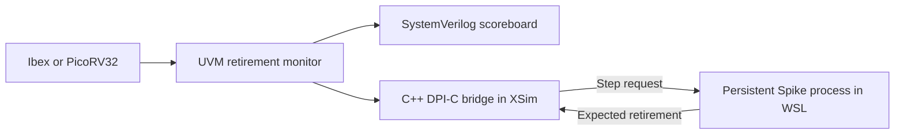

# RISC-V CPU Verification

A SystemVerilog UVM 1.2 environment verifies the pinned lowRISC Ibex and
PicoRV32 cores in Vivado XSim. A C++ DPI-C bridge steps Spike during simulation
and compares each retirement. Python's standard library coordinates the builds,
seeded regressions, trace comparisons, and coverage reports.

[Results](#results) · [Architecture](#architecture) · [Test strategy](#test-strategy) · [Setup](#setup) · [Run verification](#run-verification) · [Repository map](#repository-map) · [Scope](#scope)

## Results

| Measure | Qualification | Extended random campaign |
| --- | ---: | ---: |
| CPU, program, and seed cases passed | 12 | 8 |
| Positive UVM runs passed | 24 | 16 |
| Live Spike retirement matches | 2,020 | 1,776 |
| Deliberately injected live checker mismatches detected | 36/36 | 24/24 |
| Declared functional bins hit in each CPU's native merge | 60/60 | 60/60 |

All positive runs finished with zero UVM errors, fatals, or assertion failures.
The qualification also passed 175 Python automation checks. Across the two
campaigns, eight distinct random instruction bodies produced 3,552 live
comparisons in random runs. Smoke and directed corners brought the combined
total to **3,796 live comparisons across 40 positive UVM runs**.

[Qualification report](evidence/qualification/report.md) · [Extended campaign report](evidence/extended-random/report.md) · [Extended native coverage](evidence/extended-random/coverage.json) · [Program body hashes](evidence/extended-random/corpora.json)

[Back to top](#risc-v-cpu-verification)

## Architecture

| Layer | Responsibility |
| --- | --- |
| SystemVerilog UVM | Generates programs and memory timing stimulus, monitors the DUT, checks protocols and architectural state, and samples functional coverage. |
| Spike and DPI-C | Steps an independent Spike instance on each observed retirement and compares the expected architectural result in C++. |
| Python automation | Builds and runs the tools, schedules processor and seed cases, validates traces and manifests, merges native coverage, and writes reports. |

Ibex uses separate instruction and data memory agents. PicoRV32 uses a
valid/ready adapter. Both feed a shared SystemVerilog scoreboard and a Spike
subscriber through passive retirement observations.



The Windows transport exchanges step requests and reference results with the
persistent WSL process. Spike starts from the same program image and computes
its own register and memory state. The comparison checks instruction PC and
encoding, destination register and result, and relevant word-memory effects.
The offline adapter independently replays saved traces. [Architecture details](docs/architecture.md) · [DPI-C contract](docs/spike-dpi.md)

[Back to top](#risc-v-cpu-verification)

## Test strategy

- **Smoke** checks basic execution, memory traffic, and the terminal signature.
- **Directed corners** exercise arithmetic boundaries, dependencies, loads and stores, and taken and untaken branches.
- **Constrained-random programs** generate 64 instruction body items after a directed setup. Each complete program retires 111 instructions. Each seed runs on both CPUs with and without added memory stalls, for 444 live comparisons per seed.
- **Observation controls** deliberately corrupt a register result, PC, or store value at the live checker. The runner requires the intended mismatch diagnostic.
- **Native coverage** uses XSim functional covergroups for instruction families, branches, directed corner conditions, random ALU operations, and scratch addresses. XCRG merges the actual databases across seeds.

The separate native UVM scenario runner exercises reset recovery and Ibex
interrupts. The RTL mutation runner builds isolated DUT variants and records
the intended checker diagnostics. [Program profiles](docs/programs.md) · [Verification plan](docs/verification-plan.md) · [RTL mutation runner](docs/mutations.md)

[Back to top](#risc-v-cpu-verification)

## Setup

- Windows Git and Python 3.12 or later.
- Vivado XSim with UVM 1.2. The recorded qualification used XSim 2025.2.
- Ubuntu WSL with `python3`, `g++`, `make`, and `device-tree-compiler`.

Set `IBEX_PYTHON` to the Python executable if it is outside PATH. Set
`VIVADO_BIN` if XSim is outside the launcher's discovery paths. The first run
fetches the pinned Spike source from GitHub and compiles it in WSL.

## Run verification

From the repository root in PowerShell:

```powershell
.\scripts\verify.ps1
```

This builds both Spike adapters, runs the Python checks, qualifies smoke and
corners on both CPUs, runs the four-seed random matrix, and merges functional
coverage. The report, manifest, and stage logs go to a fresh folder under
`build/releases/`. Pass `-Output build/releases/my-run` to name the folder.

### Run the extended random campaign

After building the Spike adapters, run the four additional seeds and merge
their coverage. Use fresh output paths for a repeat run.

```powershell
python -S scripts/run_regression.py --config config/regressions/live-random-extended.json --output build/regressions/live-random-extended
python -S scripts/export_coverage.py --regression build/regressions/live-random-extended --output build/coverage/live-random-extended
```

[Back to top](#risc-v-cpu-verification)

## Repository map

| Path | Contents |
| --- | --- |
| [`tb/uvm/`](tb/uvm/) | UVM agents, sequences, monitors, scoreboard, coverage, and DUT harnesses |
| [`verification/reference/`](verification/reference/) | Spike adapters and DPI-C transport |
| [`scripts/`](scripts/) | Tool launchers, regression and mutation runners, and coverage export |
| [`config/regressions/`](config/regressions/) | Program, processor, and seed matrices |
| [`evidence/`](evidence/) | Qualification and extended campaign reports |

## Scope

The live reference checks normal single-hart programs in the tested RV32I
subset. Reset and interrupt scenarios have separate native UVM checks. The
60-bin result measures the declared functional coverage model. The project
targets CPU simulation. See [third-party sources and licenses](THIRD_PARTY.md)
for the pinned upstream revisions.

[Back to top](#risc-v-cpu-verification)
