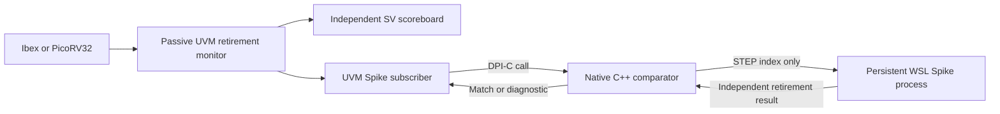

# Live Spike checking through DPI-C

The [qualification report](../evidence/qualification/report.md) records both CPU adapters, the four random seeds and native coverage results.

## Responsibilities

1. **UVM** generates the program, drives memory timing, observes both CPU
   implementations, checks protocols, runs the private SystemVerilog predictor
   and collects coverage.
2. **Spike** supplies an additional independent architectural reference.
   The optional `riscv_spike_checker` subscriber passes retirement observations
   through SystemVerilog DPI-C to a C++ comparator.
3. **Python** builds and launches tools, validates manifests, collects results
   and schedules regressions. It does not supply instruction semantics.

## Windows/WSL boundary

XSim is a Windows program; the existing pinned Spike libraries are Linux
libraries. This implementation links a native Windows C++ transport into XSim
using `xsc` and `xelab -sv_lib`. It starts one persistent WSL process containing
the pinned Spike library per simulation. This is live process-based
co-simulation through DPI-C, rather than linking Linux Spike into the Windows
simulator address space.



The initial program image is shared, but no observed DUT register or memory
value is supplied to Spike. Each retirement callback issues exactly one STEP
request; Spike computes one instruction and returns its architectural result.
The transport compares PC, instruction, destination register/result and
meaningful word-memory address/mask/data. The following retirement checks the
next instruction PC; FINISH validates the final next PC and signature.
Architecturally irrelevant RVFI fields are ignored, including stale memory
fields on non-memory instructions and register data for x0.

The existing independent SV scoreboard, bus monitors and assertions remain
active. The live checker is an additional architectural comparison, not a
replacement for protocol checking or functional coverage.

## Running

First build the existing pinned offline Spike reference according to
[spike.md](spike.md). Then build the interactive adapter against its cache:

```powershell
python -S scripts/build_spike_live.py
.\scripts\run.ps1 --full --spike-live
.\scripts\run.ps1 --full --spike-live --processor picorv32_rv32i
python -S scripts/run_regression.py --config config/regressions/live-directed.json --output build/regressions/my-live-run
```

Use `--program corners` or `--program random` to select the corresponding
normal program. The launcher compiles the native transport and UVM sources,
records source/build identities, and checks both no-added-delay and stalled
profiles. It also requires the original SV observation control plus three
live-checker controls: register-result, PC and store-data corruption.
These controls alter only observations; they are not RTL mutation campaigns.
The directed matrix selects smoke and corners on both CPUs. The release launcher
also runs the four-seed random matrix. Both matrices compare saved traces against
offline Spike.

`spike-live.log` records the request/response exchange and each successful
comparison. Profile copies are retained before the next simulation starts.
Only a complete FINISH acknowledgement, zero positive-run UVM errors/fatals,
and all expected controls can qualify a suite as passing.

## Current contract and limits

The live path accepts pristine RTL, normal full-mode smoke/corners/random
programs, one RV32 hart, entry 0x80, zero initial registers and RAM, and the
existing terminal signature. The program may write its scratch memory normally.
The supported ISA window is the same bounded RV32I subset as the offline
bridge. Matching instruction results does not check cycle timing.

Live reset epochs, asynchronous interrupts, debug, exceptions and CSR programs
are not supported. Their configurations are rejected before simulation;
existing native reset/IRQ tests and scoped offline comparisons retain their
separate evidence. The default run without `--spike-live` retains the original
flow.

The native transport has bounded wall-clock waits and terminates the child on
failure/close. Build manifests pin the upstream revision and record source and
executable hashes. The offline adapter supports trace replay.

XSim's bundled UVM library may print `UVM_NO_DPI` messages for its own helper
functions. Those messages do not disable these separately imported DPI-C
functions; the live audit and completion markers establish their execution.
The launcher passes forward-slash source paths because XSim embeds DPI caller
filenames into generated C++ strings. The transport uses C-runtime buffers to
avoid importing a conflicting MinGW C++ standard library into the engine.

## Tool reference

AMD documents `xsc` compilation and `xelab`'s `-sv_lib`/`-sv_root` binding in
[UG900](https://docs.amd.com/r/2025.2-English/ug900-vivado-logic-simulation/xelab-xvhdl-and-xvlog-xsim-Command-Options).
The installed XSim 2025.2 `xsc -help` also supplies the local compiler switches.
