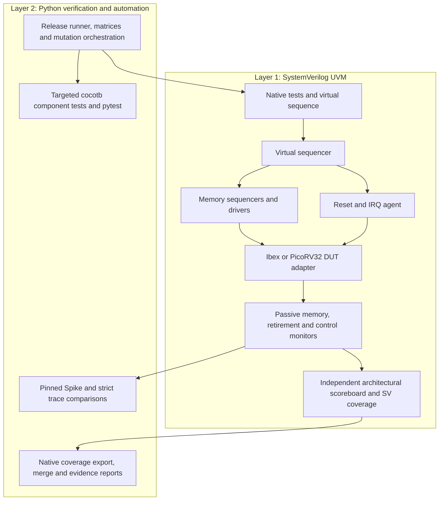

# Bounded CPU verification v1

Run the complete local acceptance flow from the project folder in PowerShell:

```powershell
.\scripts\v1.ps1
# An explicit fresh output directory is useful for a named release:
.\scripts\v1.ps1 -Output build/releases/my-v1
```

The command creates the project Python environment if absent, installs the
pinned verification dependencies into that environment, checks installed
Vivado/Questa and the pinned Spike build, then executes every acceptance stage.
It preserves failed runs and requires a fresh output directory. Read
`release.json` and `report.md` in the reported directory. A missing simulator,
license, reference build, coverage database or test result fails the release.

This PC uses Vivado/XSim 2025.2 with UVM 1.2 for CPU acceptance. Questa Intel
FPGA Starter 2024.3 supplies VPI for the complementary cocotb register-file
tests. The Starter license does not execute SV randomize or covergroups; its
procedural UVM alternative is outside this full-mode release. Python 3.12,
cocotb 2.0.1 and pytest 8.4.2 are the tested dependency versions.

Spike runs in Ubuntu WSL. For a new machine, install the build prerequisites
described in [spike.md](spike.md), then use `v1.ps1 -BuildSpike` to build the
pinned reference before qualification. `VIVADO_BIN`, `QUESTA_BIN` and
`IBEX_PYTHON` select other installed tool paths. Building Spike can download the
pinned upstream source; an ordinary v1 run uses and verifies the existing build.

## Acceptance stages

| Stage | Scope and gate |
| --- | --- |
| Utility tests | Configuration, trace validation, independent targeted models, mutation qualification, reset/IRQ audits and native coverage parsing |
| Baseline matrix | Both CPU implementations; smoke and corners; seeds 20261029/20261030; two positive timing profiles per CPU case; actual Spike comparisons; two complementary cocotb cases |
| Random matrix | Both CPU implementations; seeds 20261029–20261032; 64 actual SV-randomized body instructions and eight randomized schedules per profile; legality, replay, diversity, independent UVM and Spike checks |
| Advanced UVM | Reset and factory scenarios on both CPUs, plus an Ibex machine-external interrupt scenario; each has a native observation-corruption control |
| RTL mutations | Four isolated Ibex and four isolated PicoRV32 mutations; fresh clean baselines; intended first UVM diagnostic; architectural prefix comparison against actual Spike |
| Native coverage | Individual XCRG reports for every random positive profile; real database merges per CPU and combined; every declared scoped bin must be covered |

Each matrix CPU case invokes `scripts/run_uvm_tests.py`. Its ordinary acceptance
requires two positive profiles, clean UVM error/fatal counts, successful
completion, protocol/assertion checks, intended counters and an observation
corruption control. Source and vendor identities are checked throughout. The
release also records simulator commands, seeds, raw CSV traces, reference
records, coverage databases and stage logs. Replaying a case uses its recorded
command with a new output directory.

## Two layers and coordinated scenarios



The virtual sequence starts the existing memory-policy sequences on the real
agent sequencers and coordinates reset or interrupt commands through a control
sequencer. A demonstrated UVM factory override creates a derived memory-policy
sequence that uses legal maximum delays. Runtime type checks, executed override
call counts, measured interface stalls and a completed virtual sequence are
required; registration alone is insufficient.

For Ibex, reset interrupts an accepted data request before its response. For
PicoRV32's atomic valid/ready protocol, reset interrupts a pending unaccepted
request. A passive control monitor records the observed boundary. Drivers abort
pending work, the independent predictor starts from its declared reset state,
and the restarted 47-retirement program must complete. Raw observations retain
both epochs. The aborted prefix is compared only as an incomplete prefix; the
final epoch receives a full independent Spike comparison.
The restart program writes every nonzero register before reading it on the
checked path. PicoRV32's `REGS_INIT_ZERO` applies at simulation initialization;
its register array is not cleared by this mid-test reset. This bounded test
therefore checks transaction abort and program restart, without claiming a
register-array reset or retention test.

The Ibex IRQ program sets vectored `mtvec=0x201`, enables machine external
interrupts, and parks at `0x9c`. A physical external IRQ must enter the handler
at `0x22c`, report `mcause=0x8000000b` and `mepc=0x9c`, execute MRET, resume the
mainline and store the completion signature. The predictor models this bounded
CSR/event contract independently; a passive CSV audit checks the observed path,
flags and input pulse. PicoRV32's custom interrupt ISA is outside this test.
The offline Spike bridge does not synchronize external interrupts, so this
scenario makes no Spike interrupt-comparison claim.

## Coverage and mutation interpretation

There are five scoped covergroups with 20 coverpoints/crosses and 60 total bins:
15 opcode/branch bins, 22 directed corner/ALU bins, five random-body instruction
families, ten random-body ALU operations, and eight random scratch-memory words.
The three random-body groups sample only the 64-instruction random body, not
the directed prefix. Individual seeds may leave ALU or scratch-word bins open.
XCRG merges their actual databases, and the release requires closure separately
for each CPU as well as in the combined merge. No percentages are averaged.
This is closure of that declared model, not full ISA or code coverage.

The mutations flip an ADD result bit, invert BEQ equality, flip an SLL result
bit and corrupt store output data on each CPU. Vendor files stay unchanged;
each mutant is a checked build copy with a patch and source hashes. Intended
checker errors are distinct from compile failures, watchdogs, infrastructure
failures or observation controls. Cascaded UVM errors are preserved and counted.
Eight targeted detections do not establish a broad mutation score.

## Review and demonstration

1. Run `v1.ps1` and open the resulting report and manifest.
2. Inspect a random case's generation metadata, program image, full UVM
   transcript and normalized retirement trace. Check the actual Spike execution
   manifest and full record comparison.
3. Open an advanced reset case's control trace and raw all-epoch trace, then the
   final epoch and its reference comparison. For IRQ, inspect the actual input
   pulse, handler records, MRET and the explicit reference limitation.
4. Open a mutant's patch, first intended checker diagnostic and Spike prefix
   divergence. Confirm its observation-corruption option was disabled.
5. Open the XCRG HTML report under `coverage/merged_<processor>/report/` and
   compare its closed bins with an individual seed's remaining holes.

The checked-in manual CI workflow has a hosted Windows utility job and a native
job for a self-hosted Windows runner labelled `riscv-uvm` with the installed
simulators and WSL reference. The workflow is a local configuration until it is
published and actually run; local release evidence is not a CI execution claim.

The owner has accepted bounded CPU v1 as the finished project scope. SoC
peripherals, UVM bus agents and RAL are not planned or required. Broader ISA,
random control flow, asynchronous Spike event synchronization and additional
mutation classes are optional extensions. DE10-Lite implementation is also
optional and would use Quartus.
